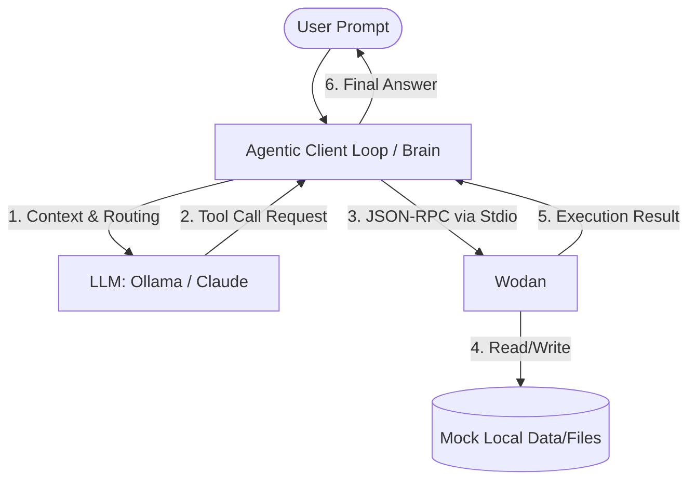

# mcp-agentic-journey
A journey into understanding the concepts behind MCP and how to implement it into a useable Agentic AI assistant. 

The goal is to build an assistant that interface with local machine (files, notes), with the potential to migrate to a cloud service, and integrate third-party open-source MCP servers to expand capabilities.

---
## Architecture Blueprint

---

## Tech Stack & Frameworks
* **Language:** Python 3.11+
* **Server Framework:** FastMCP (Anthropic)
* **Orchestration / Client:** LangChain /CrewAI *(Targeting)*
* **LLMs:** [Insert: Ollama Local Llama 3.2 or Anthropic Claude API]

---
## Journey Log & Milestones

### Phase 1: Conceptual Foundations & Hello World MCP
* **Goal:** Understand MCP objectives (tools, resources, prompts) and set up a standalone server
* **Status:** In progress
* **What was done:**
    * Initialized this GitHub repository with evironment isolation.
    * Researching the difference between MCP clients and servers.
* **Blockers & Breakthroughs:**
    * *Log any difficult setup steps or JSON-RPC confusion here.*

### Phase 2: The Agentic Client Loop (The Brain)
* **Goal:** Write the client loop that allows an LLM to autonomously discover and execute custom server tools.
* **Status:** Upcoming

### Phase 3: Multi-Server Integration & Expansion
* **Goal:** Configure the AI assistant to connect to multiple MCP servers simultaneously (combining a local notes tool with open-source web search server)
* **Status:** Upcoming

---

