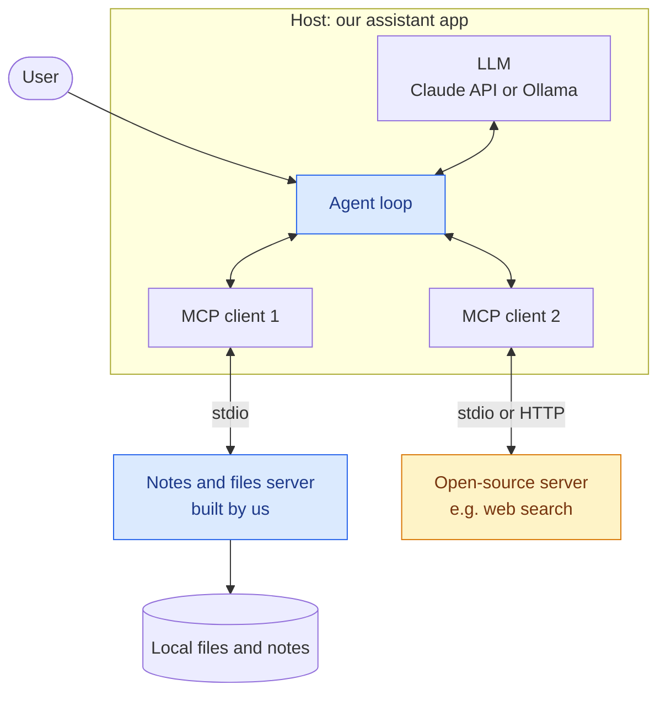
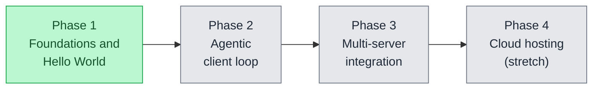
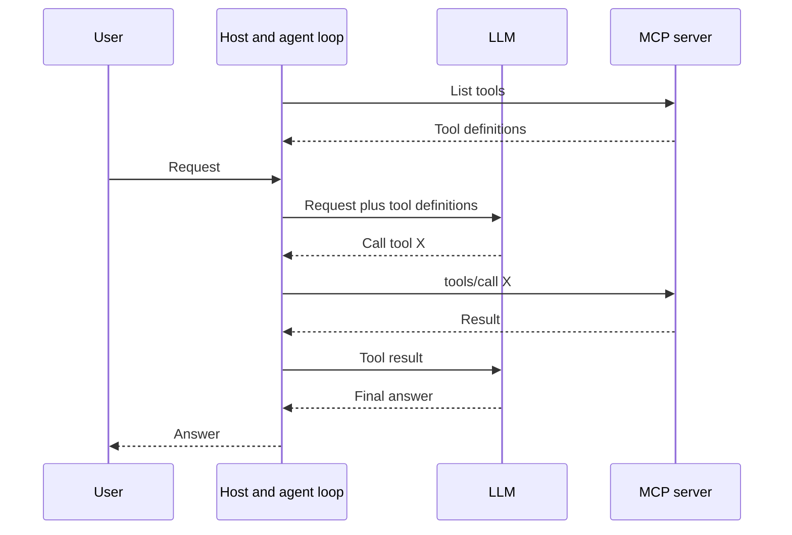

# mcp-agentic-journey

A journey into understanding the concepts behind MCP and how to implement it into a usable Agentic AI assistant.

The goal is to build an assistant that interfaces with local machine (files, notes), with the potential to migrate to a cloud service, and integrate third-party open-source MCP servers to expand capabilities.

Background research (what MCP is, why it exists, how it works) lives in `docs/mcp-research.md`.

## Architecture Blueprint

The assistant is a **host** application. Inside it, an agent loop connects an LLM to one or more MCP clients, and each client talks to one MCP server.



### Tech Stack & Frameworks

* Language: Python 3.11+
* Package manager: uv
* Server Framework: Official MCP Python SDK (`mcp`), using the `MCPServer` class
* Orchestration / Client: SDK `Client` first (hand-written loop), then compare with LangChain / CrewAI (Targeting)
* LLMs: Undecided. Candidates are Ollama (local Llama 3.2) or the Anthropic Claude API. Record the decision in the Journey Log.
* Debug tool: MCP Inspector (launched with `mcp dev`)

A note on naming: "FastMCP" refers to two different things. Inside the official SDK, the high-level server class was `FastMCP` in SDK 1.x and was renamed `MCPServer` in SDK 2.x. Separately, there is a community-maintained package called `fastmcp`. This project uses only the official SDK to keep the learning path clear.

### Design Principles

* Least privilege: the notes server can only touch an explicitly allowed directory.
* Read before write: start with read-only tools, add write and delete tools later behind a confirmation step.
* Treat tool output as untrusted: text returned by a tool can contain instructions aimed at the model.
* Read the source of any third-party server before connecting it to a machine that holds personal files.

## Journey Log & Milestones



### Phase 1: Conceptual Foundations & Hello World MCP

* Goal: Understand MCP objectives (tools, resources, prompts) and set up a standalone server
* Status: In progress
* What was done:
   * Initialized this GitHub repository with environment isolation.
   * Researching the difference between MCP clients and servers.
* Up next:
   * Build the hello world server (see "Running This Project Locally").
   * Inspect it with MCP Inspector and call each primitive by hand.
   * Capture one raw JSON-RPC exchange (a `tools/call`) and annotate it.
* Blockers & Breakthroughs:
   * 2026-10-06: Many tutorials do not match the current SDK. The MCP spec and the Python SDK both had major releases on 2026-07-28 (the protocol became stateless, and `FastMCP` was renamed `MCPServer`). Decision: target the current spec and SDK 2.x, and treat older tutorials as conceptual guides only.
   * Log any other difficult setup steps or JSON-RPC confusion here.

### Phase 2: The Agentic Client Loop (The Brain)

* Goal: Write the client loop that allows an LLM to autonomously discover and execute custom server tools.
* Status: Upcoming
* Planned approach:
   * Connect to the Phase 1 server with the SDK `Client`.
   * Convert MCP tool definitions into the LLM provider's tool-calling format.
   * Loop until the model gives a final answer, with a maximum iteration limit.
   * Ask the user for confirmation before any write operation.



### Phase 3: Multi-Server Integration & Expansion

* Goal: Configure the AI assistant to connect to multiple MCP servers simultaneously (combining a local notes tool with open-source web search server)
* Status: Upcoming
* Planned approach:
   * Run two servers at once and avoid tool name collisions.
   * Evaluate one open-source server before installing it (source, maintainers, permissions).
   * Compare the hand-written loop with LangChain / CrewAI MCP adapters.

### Phase 4: Cloud Hosting (Stretch)

* Goal: Run the server remotely instead of as a local subprocess.
* Status: Upcoming
* Planned approach:
   * Switch the transport from stdio to Streamable HTTP.
   * Add authentication.
   * Containerize and deploy to a cloud service.

## Running This Project Locally

1. Prerequisites

Ensure that Python 3.11+, Node.js, and the 'uv' package manager are installed. 'uv' is a modern project manager for Python, and considered a 'multi-tool' when working with various server packages or experimental frameworks. Node.js is needed because `mcp dev` launches the MCP Inspector, which is a Node tool. An LLM API key is needed from Phase 2 onward if using a hosted model.

2. Installation

```
# Clone the repository
git clone https://github.com/<your-username>/<name_of_repo>.git
cd <name_of_repo>

# Create a virtual environment and install dependencies
uv venv
source .venv/bin/activate #On Windows use: .venv\Scripts\activate
uv pip install "mcp[cli]"
```

Check the install worked:

```
mcp version
```

Suggested layout:

```
mcp-agentic-journey/
├── README.md
├── .gitignore
├── .env.example
├── docs/
│   └── mcp-research.md
├── servers/
│   └── notes_server/
│       └── server.py
└── client/
    └── smoke_test.py
```

3. Hello World Server

# using python to build out server - upcoming
