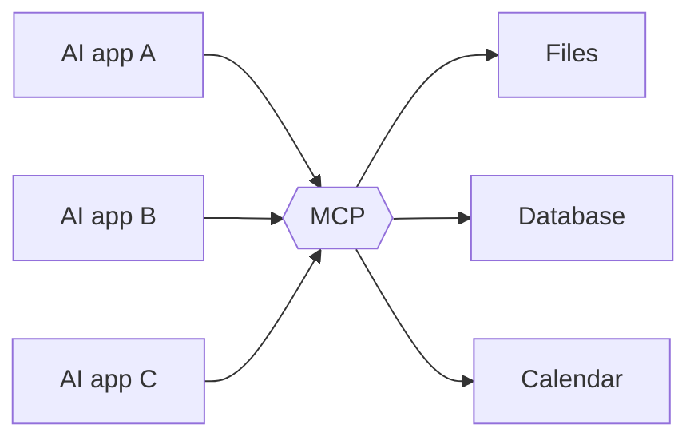
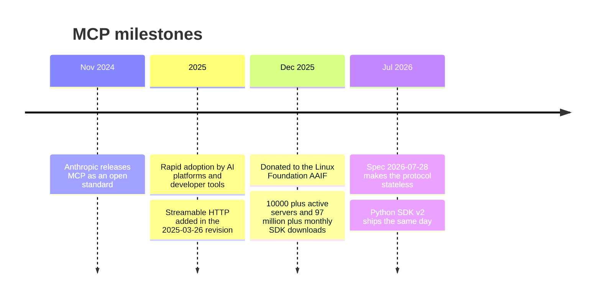
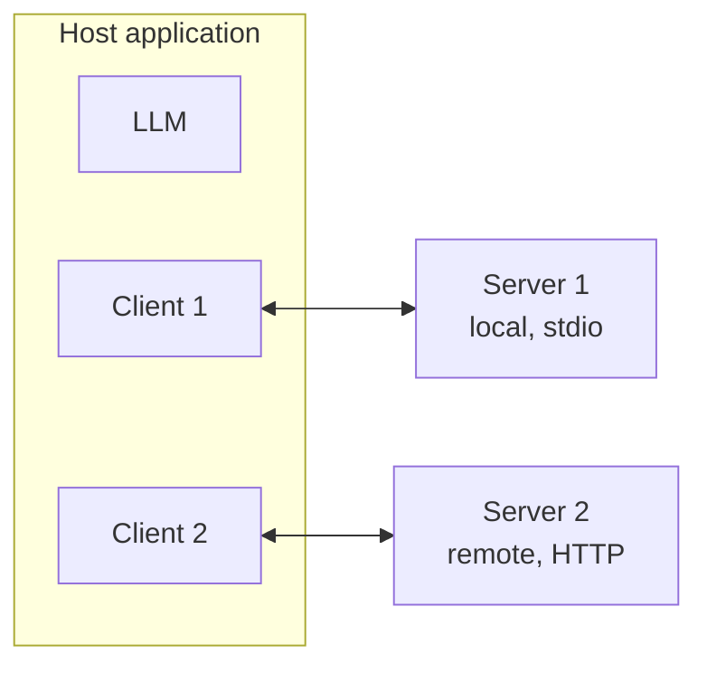
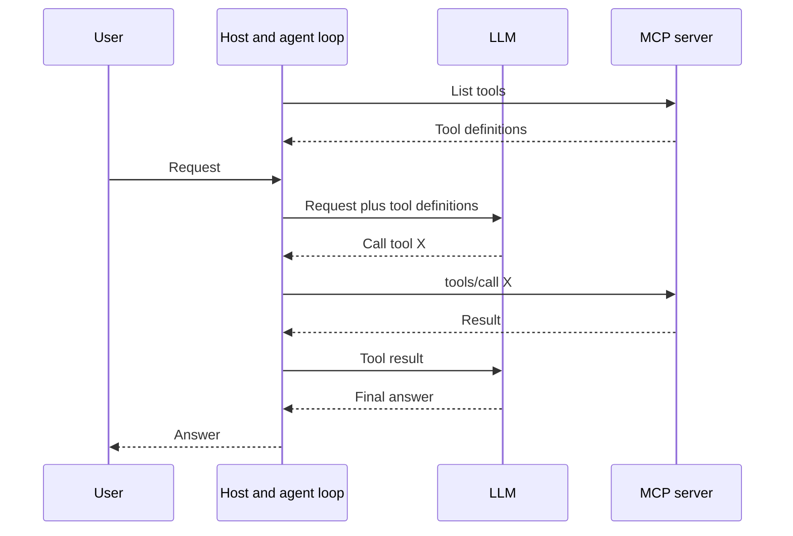
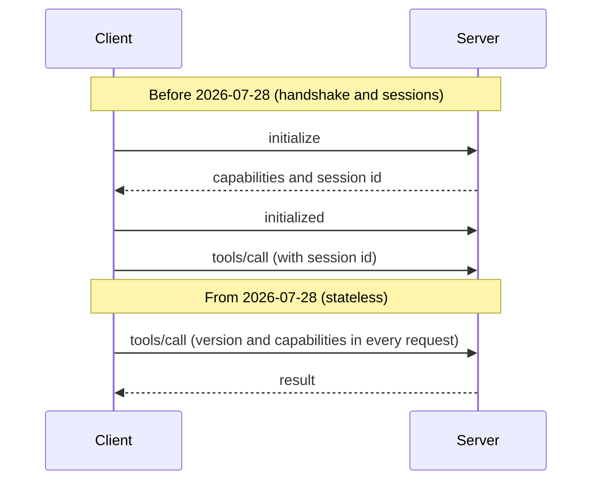

# Model Context Protocol (MCP): Research Notes

Compiled 2026-10-06. MCP is evolving quickly, and the spec and SDKs changed substantially in July 2026. Re-verify version-specific details before citing them.

Sections:

1. What is MCP?
2. Why did it come about?
3. How it works
4. What changed in the 2026-07-28 spec
5. How MCP is used
6. MCP compared with related ideas
7. Security considerations
8. Implications for cloud hosting
9. Glossary
10. Open questions for this project
11. Sources

---

## 1. What is MCP?

The **Model Context Protocol** is an open standard that lets AI applications (Claude, ChatGPT, Cursor, VS Code and others) discover and use external tools, data, and prompt templates through one common interface, rather than a custom integration for every app-and-service pair.

Key points:

* It is a **protocol (a specification)**, not a product or a library. SDKs exist in many languages, but the contract is the spec.
* Messages are **JSON-RPC 2.0**.
* The spec is **versioned by date**, not number. Revisions so far: 2024-11-05, 2025-03-26, 2025-06-18, 2025-11-25, and 2026-07-28 (current).
* It was created by **Anthropic** and released in November 2024.
* In December 2025 Anthropic donated MCP to the **Agentic AI Foundation (AAIF)**, a directed fund under the **Linux Foundation**, co-founded by Anthropic, Block, and OpenAI. Anthropic stated that MCP's maintainer and governance model continued unchanged.

A useful one-line analogy: MCP is to AI tools what USB-C is to devices. It is a standard port, so any compliant client can plug into any compliant server.

---

## 2. Why did it come about?

### The N x M integration problem

Before MCP, connecting an LLM application to an external system (a database, a file system, a calendar, GitHub) meant writing custom glue code. With N AI applications and M services, the ecosystem needed up to N x M separate integrations, each with its own conventions for describing tools, handling authentication, and formatting results.

MCP turns this into N + M. Each application implements the client side once, each service implements the server side once, and they all interoperate.



### Models needed context and the ability to act

LLMs are limited to their training data and whatever is pasted into the prompt. Useful assistants need to read live data and take actions. Function calling (provider-specific tool APIs) solved part of this, but the definition and execution of those tools was still custom for each application. MCP standardizes the layer around tool calling: how tools are discovered, described, and invoked, and how results come back.

### Prior art: the Language Server Protocol

MCP's design was explicitly inspired by the **Language Server Protocol (LSP)**, which solved the same N x M problem for code editors and programming languages. MCP applies the same idea to AI applications and their capabilities.

### Adoption timeline



By December 2025, first-class MCP client support existed across ChatGPT, Claude, Cursor, Gemini, Microsoft Copilot, VS Code and more.

---

## 3. How it works

### 3.1 The three roles

* **Host**: the AI application the user interacts with. It contains the LLM and manages one or more clients. Examples: Claude Desktop, an IDE, or our assistant.
* **Client**: a component inside the host that maintains the connection to one server. Example: the MCP `Client` in our agent code.
* **Server**: a program that exposes capabilities (tools, resources, prompts) over MCP. Examples: our notes server, a GitHub server, a web search server.



Important: **the model never talks to a server directly.** The host's client mediates every call. This is where a host can enforce permissions and ask the user for confirmation.

### 3.2 Two layers

* **Data layer**: the JSON-RPC messages and the primitives (what can be asked and answered).
* **Transport layer**: how those messages travel.

### 3.3 Server primitives

**Tools** are controlled by the model.

* Functions with a name, a description, and a JSON Schema for their inputs.
* The model decides when to call them.
* Examples: `search_issues`, `create_invoice`, `read_note`.

**Resources** are controlled by the application.

* Read-only context identified by a URI, which the host decides to load.
* Examples: a file, a database row, `notes://welcome`.

**Prompts** are controlled by the user.

* Reusable, parameterized prompt templates the user picks.
* Examples: `/summarize`, `/code-review`.

Core methods you will see on the wire: `tools/list`, `tools/call`, `resources/list`, `resources/read`, `prompts/list`, `prompts/get`.

The spec says clients must treat tool annotations (hints such as read-only or destructive) as untrusted unless the server itself is trusted.

### 3.4 Transports

* **stdio**: for local servers. The host launches the server as a subprocess and talks over stdin and stdout. It is simple and needs no network. Never write logs to stdout, use stderr.
* **Streamable HTTP**: for remote or cloud servers. HTTP POST requests with optional streaming responses. Introduced in the 2025-03-26 revision.
* **HTTP+SSE**: the legacy remote transport, now deprecated in favor of Streamable HTTP.

### 3.5 Example exchange

A client asking a server to run a tool looks like this (simplified, field details vary by spec revision).

Request, client to server:

```json
{
  "jsonrpc": "2.0",
  "id": 7,
  "method": "tools/call",
  "params": { "name": "add", "arguments": { "a": 2, "b": 3 } }
}
```

Response, server to client:

```json
{
  "jsonrpc": "2.0",
  "id": 7,
  "result": { "content": [ { "type": "text", "text": "5" } ] }
}
```

### 3.6 The agent loop (where MCP fits)

MCP does not make an agent by itself. The agent loop lives in the host.



MCP standardizes the two steps where the host talks to the server (listing tools and calling a tool). Everything involving the LLM, and the loop and stop conditions around it, is the LLM provider's API plus your own orchestration code. This is exactly what Phase 2 of the project builds.

---

## 4. What changed in the 2026-07-28 spec

This matters because most tutorials and blog posts describe the older, session-based protocol.



### Major changes

* **Stateless protocol.** The `initialize` and `initialized` handshake and the `Mcp-Session-Id` header were removed. Every request now carries its own protocol version and client capabilities in `_meta`. Servers that need state across calls use explicit server-issued handles passed as ordinary tool arguments.
* **`server/discover`.** Servers must implement this method to advertise their supported versions, capabilities, and identity.
* **`subscriptions/listen`.** Replaces the old GET endpoint and resource subscribe and unsubscribe, giving one long-lived stream for opted-in change notifications.
* **Multi Round-Trip Requests (MRTR).** Replaces servers sending requests to the client mid-call (for elicitation, for example). A server instead returns an `input_required` result, and the client retries with the requested information.
* **Tasks** (long-running operations) moved out of the core protocol into an official extension.
* **No SSE stream resumability.** If a stream breaks, the client re-issues the request.

### Smaller changes

* Cache hints (`ttlMs`, `cacheScope`) on list and read results.
* Standard HTTP headers (`Mcp-Method`, `Mcp-Name`) on POST requests.
* OpenTelemetry trace context conventions.
* JSON Schema 2020-12 keywords allowed in tool schemas.
* Authorization hardening, such as issuer validation per RFC 9207.
* The "resource not found" error code changed to -32602.

### Deprecated (still functional, scheduled for removal)

* The Roots, Sampling, and Logging client features.
* The HTTP+SSE transport.
* OAuth Dynamic Client Registration (RFC 7591), in favor of Client ID Metadata Documents.
* A formal feature lifecycle policy now requires at least a 12 month deprecation window.

### Impact on the Python SDK

* **MCP Python SDK v2.0.0** (stable, released alongside the spec) speaks the new protocol and still serves 2025-era clients from the same server.
* The high-level server class `FastMCP` was renamed **`MCPServer`**, and the module path moved from `mcp.server.fastmcp` to `mcp.server.mcpserver`. The `@mcp.tool()`, `@mcp.resource()` and `@mcp.prompt()` decorators are unchanged.
* Protocol types moved to a separate `mcp-types` package.
* A first-class `Client` class was added.
* The standalone community **FastMCP** package is a separate project that builds on the official SDK. Its v4 tracks the SDK v2 rebuild.

---

## 5. How MCP is used

### Everyday uses

* **Coding assistants** connecting to repos, issue trackers, docs, and databases.
* **Chat assistants** connecting to calendars, email, file storage, and company knowledge bases.
* **Automation and agent workflows** chaining tools across services, for example read a ticket, query a database, then update a document.
* **Local machine integration**: file systems, notes apps, and shell tools exposed through local stdio servers. This is the focus of this project.

### The ecosystem

* **Official and community servers**: a large and growing collection, with thousands of tracked servers. Quality and trustworthiness vary widely.
* **Registries and directories** help with discovering servers.
* **Extensions** are optional protocol additions, such as Tasks, or MCP Apps for tools that render interactive UI.

### Typical build pattern (our project)

1. Write a server exposing a few focused tools and resources.
2. Test it with the MCP Inspector.
3. Write a host and client that gives those tools to an LLM in an agent loop.
4. Add more servers. The same client code handles all of them.
5. Move a server to Streamable HTTP to host it remotely.

---

## 6. MCP compared with related ideas

* **Function or tool calling (provider APIs).** This is the model-side mechanism for requesting a tool call. MCP standardizes the tool side: discovery, schemas, execution, and results. An MCP client typically translates MCP tools into the provider's function-calling format.
* **REST APIs and OpenAPI.** Designed for developers and programs. MCP wraps capabilities in a form designed for model consumption (descriptions, schemas, standardized results) and handles discovery. An MCP server often sits on top of a REST API.
* **RAG (retrieval-augmented generation).** A technique for injecting retrieved text into prompts. MCP can be the plumbing a RAG system uses to reach data sources, but MCP is broader because it also performs actions.
* **Agent frameworks (LangChain, CrewAI and others).** Orchestration layers. Many can act as MCP clients through adapters. MCP is the connectivity standard, while frameworks provide the loop and workflow abstractions.
* **AGENTS.md.** A convention for giving coding agents project instructions. It is also hosted by AAIF, but it solves a different problem.

---

## 7. Security considerations

MCP gives models the ability to act, which raises the stakes.

**Prompt injection via tool results**

* Risk: content a tool returns (a web page, a note, an email) may contain instructions aimed at the model.
* Mitigation: treat tool output as untrusted data, limit what one session can do, and confirm sensitive actions.

**Malicious or poisoned tool descriptions**

* Risk: a third-party server can describe its tools in ways that manipulate the model.
* Mitigation: vet servers, prefer well-known sources, review tool descriptions, and pin versions.

**Over-broad permissions**

* Risk: a file server with access to the whole disk.
* Mitigation: allow-list directories, validate paths (block `..` traversal and symlink escapes), and run in a container or restricted account.

**Destructive actions**

* Risk: delete, write, or send tools invoked autonomously.
* Mitigation: start read-only and require human approval for writes.

**Untrusted annotations**

* Risk: server-supplied hints like "read-only" can be wrong or malicious.
* Mitigation: the spec says clients must not trust them unless the server is trusted.

**Credential handling**

* Risk: tokens and API keys sitting in config files or logs.
* Mitigation: use environment variables or secret stores, never commit `.env`, and follow the spec's OAuth-based authorization for remote servers.

**Supply chain**

* Risk: running a community server means running someone else's code.
* Mitigation: read the source, check maintainers and activity, and sandbox it.

---

## 8. Implications for cloud hosting

* **Local to remote means a transport change.** Move from stdio to Streamable HTTP.
* **Statelessness helps.** Because the 2026-07-28 protocol has no sessions, requests are self-contained. Servers can scale horizontally behind a load balancer and fit serverless platforms more naturally. State that must persist becomes an explicit design choice (handles, databases).
* **Authentication becomes mandatory.** A remote server must authenticate callers. The spec builds on OAuth 2.x, and the latest revision hardens it and favors Client ID Metadata Documents over Dynamic Client Registration.
* **Caching hints** (`ttlMs`, `cacheScope`) let clients and intermediaries reduce redundant list requests.
* **Local file access does not migrate.** A cloud server cannot see files on your laptop. Either keep a local server for local data and add remote servers for other capabilities (which Phase 3's multi-server design allows), or sync the data to cloud storage.
* **Observability.** OpenTelemetry trace propagation is documented, and the Python SDK ships tracing support.

---

## 9. Glossary

* **MCP**: Model Context Protocol.
* **Host**: the AI application containing the LLM and the MCP clients.
* **Client**: the per-server connection manager inside the host.
* **Server**: a program exposing tools, resources, and prompts.
* **Tool**: a model-invoked function with a JSON Schema.
* **Resource**: URI-addressed, read-only context.
* **Prompt**: a user-selected prompt template.
* **JSON-RPC 2.0**: the lightweight request and response message format MCP uses.
* **stdio**: local transport using standard input and output.
* **Streamable HTTP**: remote transport using HTTP POST with optional streaming.
* **MRTR**: Multi Round-Trip Requests, how servers ask clients for more input in the stateless protocol.
* **SEP**: Spec Enhancement Proposal, the process for changing the spec.
* **AAIF**: Agentic AI Foundation, the Linux Foundation fund that stewards MCP.
* **MCP Inspector**: a browser tool for testing servers interactively.
* **Elicitation**: a server asking the user for additional input mid-operation.

---

## 10. Open questions for this project

Useful discussion points for supervision meetings:

1. Do we target only the current stateless spec, or also study the legacy handshake and session model that most existing servers still use?
2. Hosted LLM (Claude API) versus local (Ollama): what are the trade-offs for tool-calling reliability, privacy of personal notes, and cost?
3. When do LangChain or CrewAI add value over a hand-written loop of roughly 100 lines?
4. What threat model do we adopt for a local assistant with file access, and what does "human in the loop" look like in a command line tool?
5. How should long-running work be handled now that Tasks is an extension rather than part of the core?

---

## 11. Sources

Primary:

* MCP specification 2026-07-28 changelog: https://modelcontextprotocol.io/specification/2026-07-28/changelog
* MCP specification release page: https://github.com/modelcontextprotocol/modelcontextprotocol/releases/tag/2026-07-28
* MCP Python SDK v2.0.0 release notes: https://github.com/modelcontextprotocol/python-sdk/releases/tag/v2.0.0
* MCP joins the Agentic AI Foundation, Dec 9 2025 (mirrored copy): https://modelcontextprotocol.info/blog/joins-agentic-ai-foundation/

Secondary (explainers and news coverage):

* Scalar, What is MCP: https://scalar.com/learn/mcp/what-is-mcp
* PPC Land coverage of the 2026-07-28 release: https://ppc.land/mcp-forces-ad-tech-to-rebuild-agent-servers-as-sessions-disappear/
* FastMCP v4 notes (community project): https://gofastmcp.com/development/v4-notes

Suggested next step: read the architecture and base-protocol sections of the official spec directly, and cite those over secondary sources in any write-up.
